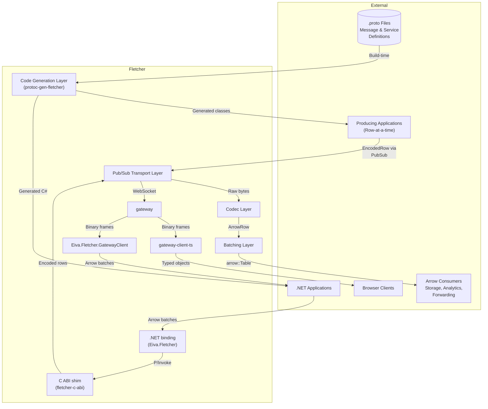
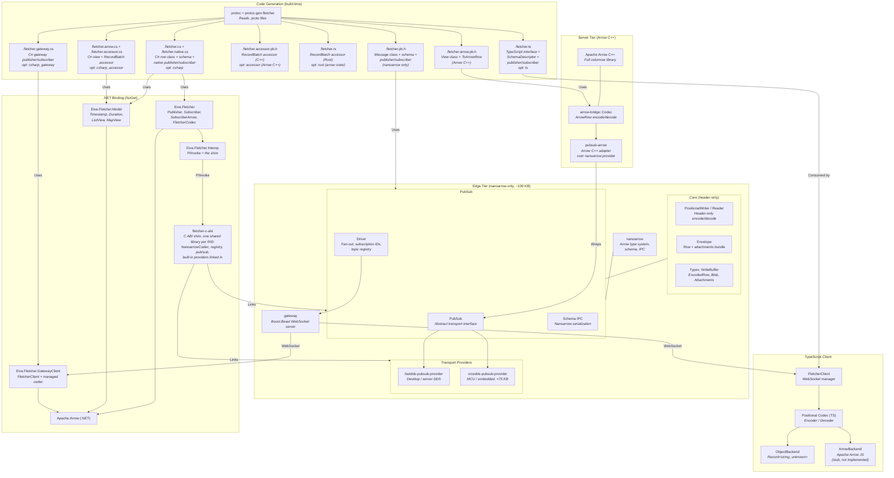
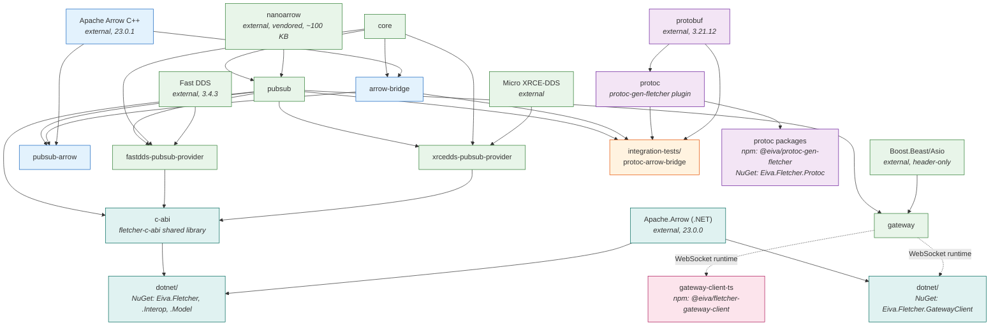
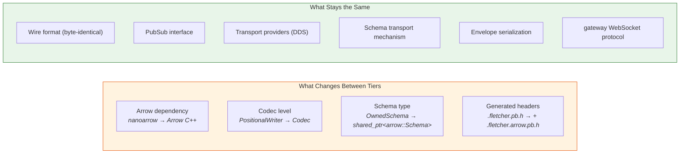

# Component and Dependency Diagram

## System Context

## Component Detail

## Dependency Graph

Every monorepo package and how it depends on every other one. Arrows point from a dependency to its consumer (X → Y means Y depends on X). External libraries are included where they cross a package boundary that matters for understanding deployment.

Legend:
- **Green** — edge tier (nanoarrow + external transports). Builds and runs without Apache Arrow C++.
- **Blue** — server tier. Adds Apache Arrow C++ on top of the edge tier.
- **Purple** — build-time code generator. Produces source files consumed at compile time, not linked at runtime.
- **Orange** — test-only artifact.
- **Pink** — TypeScript / npm. No Conan dependency on the C++ packages; the dotted arrow indicates a runtime WebSocket-protocol relationship to the `gateway`.
- **Teal** — the .NET binding. `c-abi` statically links `pubsub` and both providers (with Fast DDS, Micro XRCE-DDS and nanoarrow) into one shared library per RID, which `Eiva.Fletcher.Interop` carries; `Eiva.Fletcher.GatewayClient` loads no native code and, like the TypeScript client, reaches the `gateway` over WebSocket. The code generator's packages (purple) bring the `protoc` plugin to a build: the NuGet package carries the binary for each RID and gives MSBuild its path, for the project's own protoc call; the npm package downloads it from the GitHub Release on first use.

Note: a few C++ packages declare `core` as a *direct* requirement even though they would also pick it up transitively via `pubsub`. The direct edge is shown because it reflects the actual conanfile (set with `transitive_headers=True` for header visibility) and matters when copying a single package out of the monorepo.

## Two-Tier Deployment

## Project Structure

The monorepo is a polyrepo of mostly Conan-packaged C++ components — most top-level C++ component directories have their own `conanfile.py` and are built independently into the local Conan cache. Some top-level directories, such as `integration-tests/`, contain nested C++ components rather than a root-level `conanfile.py`. TypeScript packages get a `-ts` suffix so the language is obvious from a directory listing, and they use npm rather than Conan; `dotnet/` is one .NET solution of four NuGet packages, built with the .NET SDK over the `c-abi/` shim.

```mermaid
graph TB
    subgraph root ["Fletcher/"]
        direction TB
        ROOT_README["README.md<br/><i>Top-level repo overview + TODO backlog</i>"]
        DOCS["docs/<br/><i>Architecture documentation</i>"]
        WORKFLOWS[".github/workflows/<br/><i>ci.&lt;component&gt;.yml, cd.&lt;component&gt;.yml<br/>per-component CI and release</i>"]

        subgraph core_dir ["core/"]
            CORE_INC["include/core/<br/><i>Types, WriteBuffer,<br/>PositionalIO, Envelope</i>"]
            CORE_TEST["tests/"]
        end

        subgraph pubsub_dir ["pubsub/"]
            PS_INC["include/pubsub/<br/><i>Provider, Driver, OwnedSchema</i>"]
            PS_SRC["src/"]
            PS_TEST["tests/"]
        end

        subgraph ab_dir ["arrow-bridge/"]
            AB_INC["include/arrow_bridge/<br/><i>Codec, ArrowRowView,<br/>CRS utils</i>"]
            AB_SRC["src/"]
            AB_TEST["tests/"]
        end

        subgraph psa_dir ["pubsub-arrow/"]
            PSA_INC["include/pubsub_arrow/<br/><i>Arrow C++ adapter</i>"]
            PSA_TEST["tests/"]
        end

        subgraph plugin_dir ["protoc/"]
            PP_SRC["src/<br/><i>generator, type_mapper, main</i>"]
            PP_TEST["tests/"]
            PP_PKG["npm/, nuget/<br/><i>the plugin's npm and NuGet packages</i>"]
        end

        subgraph cabi_dir ["c-abi/"]
            CA_INC["include/fletcher/abi/<br/><i>binding.h, the C ABI</i>"]
            CA_SRC["src/<br/><i>entry points, NanoarrowCodec</i>"]
            CA_TEST["tests/"]
        end

        subgraph dotnet_dir ["dotnet/"]
            DN_SRC["src/<br/><i>the four packages</i>"]
            DN_TEST["tests/"]
        end

        subgraph integ_dir ["integration-tests/"]
            PI_ALL["<i>One directory per lane:<br/>protoc-arrow-bridge, pubsub-conformance,<br/>gateway-dotnet-crosslang, …</i>"]
        end

        subgraph dds_dir ["fastdds-pubsub-provider/"]
            DDS_ALL["<i>Full DDS provider</i>"]
        end

        subgraph xrce_dir ["xrcedds-pubsub-provider/"]
            XRCE_ALL["<i>XRCE-DDS provider</i>"]
        end

        subgraph webgw_dir ["gateway/"]
            WG_ALL["<i>WebSocket server + example</i>"]
        end

        subgraph webcl_dir ["gateway-client-ts/"]
            WC_ALL["<i>TypeScript client<br/>(npm: @eiva/fletcher-gateway-client)</i>"]
        end
    end
```

