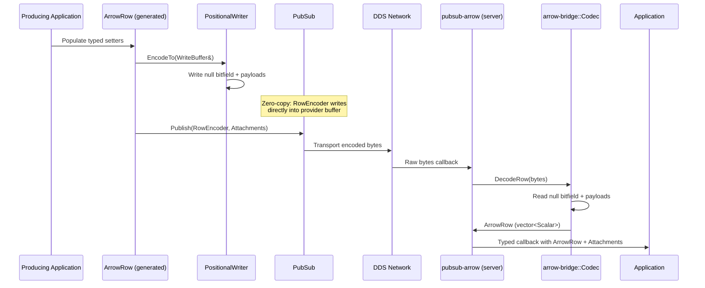
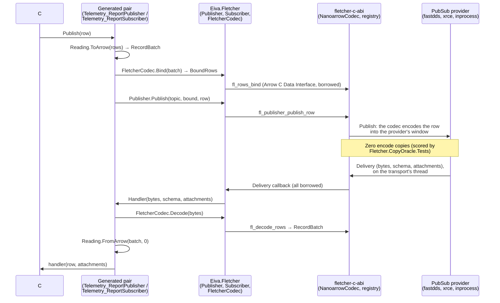
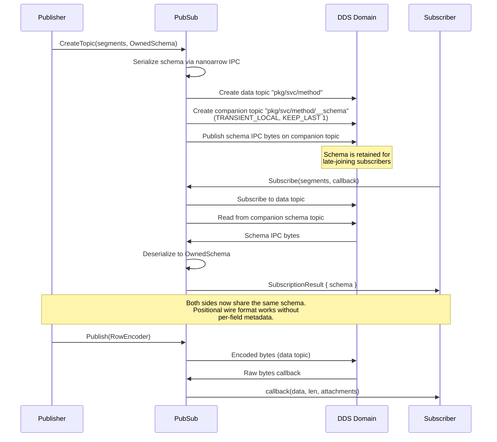
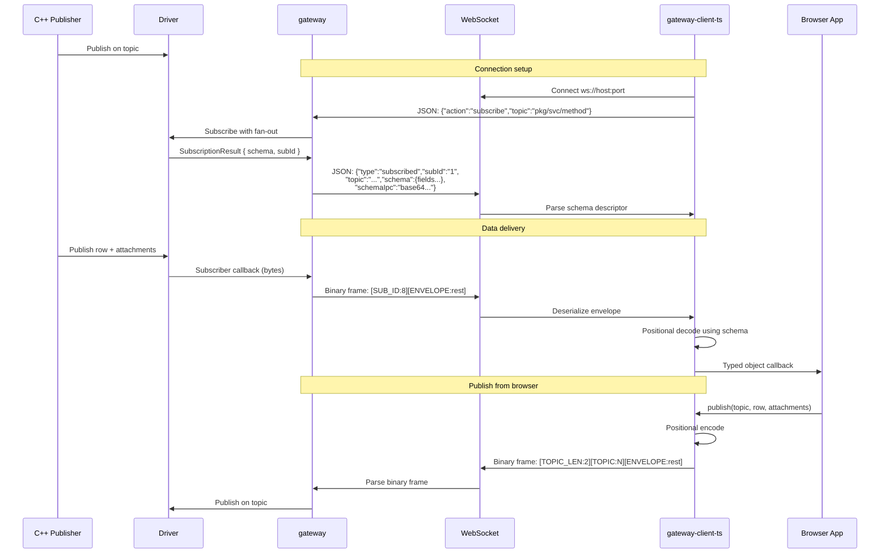
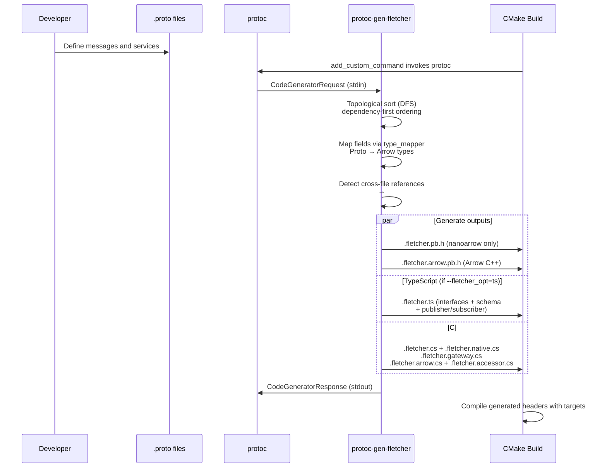
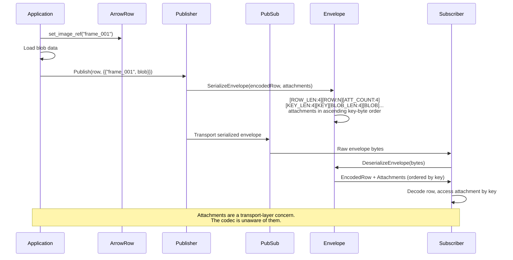
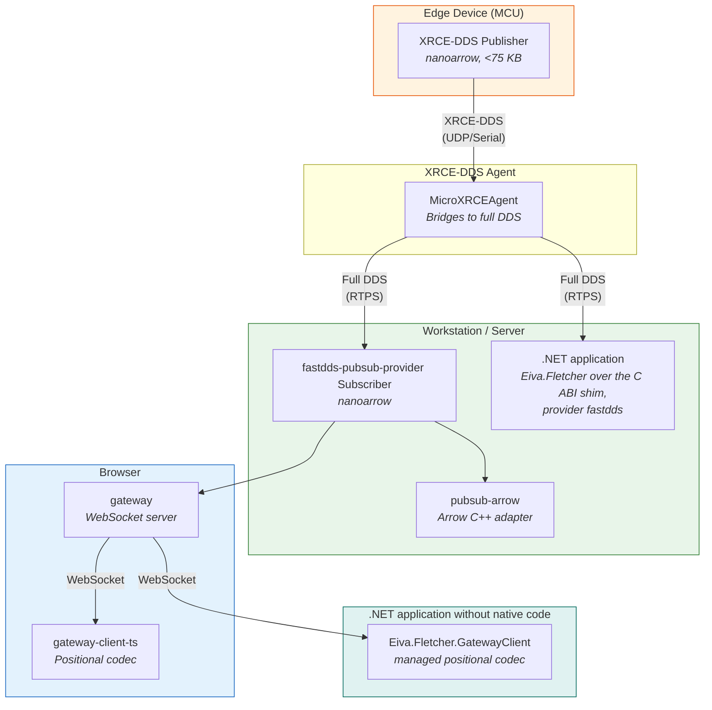

# Data Flow Diagrams

## Producer-to-Subscriber Pipeline

## .NET Publish and Subscribe (C ABI)

A C# application reaches the same transports through the C ABI shim (`fletcher-c-abi`). The generated pair turns rows into an Arrow batch; the shim's one native codec writes each row straight into the provider's window, so the wire bytes are the C++ publisher's.

## Schema Transport Flow

## Browser Delivery Flow (gateway)

`Eiva.Fletcher.GatewayClient`, the C# client, speaks the same protocol with the same frames, and so does the generated pair over either client (`<Service>_<Method>Publisher` / `Subscriber` in `.fletcher.ts`, `<Service>_<Method>GatewayPublisher` / `GatewaySubscriber` in `.fletcher.gateway.cs`), whose publisher declares its topic and schema when it is created. The C# client encodes and decodes rows with its own managed codec and loads no native code.

## Code Generation Flow

In a .NET project the build that invokes protoc is MSBuild: the `Eiva.Fletcher.Protoc` NuGet package brings the plugin and runs it on every build, and the generated `.cs` files are compiled into the project. In a TypeScript project the `@eiva/protoc-gen-fletcher` npm package brings the plugin.

## Attachment (Sidecar Blob) Flow

## Multi-Provider Interoperability

